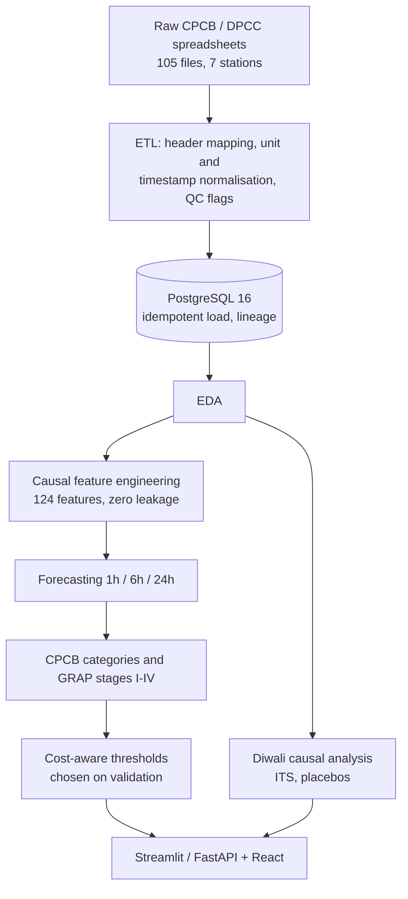

# Delhi Air Quality Risk Forecasting

**1h / 6h / 24h AQI forecasts for 7 Delhi monitoring stations, CPCB/GRAP risk alerts with cost-aware thresholds, and an honest causal look at the Diwali firecracker ban.**


Delhi's winter smog regularly pushes AQI past 400. This repository takes raw government telemetry through ETL,
leakage-safe feature engineering, multi-horizon forecasting, regulatory risk classification and causal policy
evaluation, and it reports where each step works and where it doesn't.

**Dataset:** [Delhi Air Quality Monitoring Dataset (2023–2026) on Kaggle](https://www.kaggle.com/datasets/siddharthdongardive/delhi-air-quality-monitoring-dataset-2023-2026) ·
**Code:** [GitHub](https://github.com/siddhu-exe/Air-Quality-Risk-Forecasting)

## Highlights

- **Beats persistence, modestly.** The 24h hybrid (50% persistence + 50% Ridge) has MAE skill **+0.11** over copying the last
  value on the held-out Nov–Dec 2025 winter, and the gain holds in the 2024 winter too (rolling-origin backtest).
- **Fixes a real failure.** Gradient-boosted trees capped at the training maximum (~347 AQI) and got 24h MAE 98.24 on winter; the
  linear hybrid brought it to 34.11.
- **No leakage, no test-set tuning.** Thresholds and hyper-parameters are chosen on validation; the test window is scored once.
- **Honest causal result.** The Diwali-ban effect is **not identifiable** with this data (the ban applied in every year studied).
- **Reports negatives.** Raw PM2.5 beats persistence at 1h/6h but not 24h; weather, longer training and extra tuning barely move the 24h forecast.

## Contents

[Key results](#key-results) · [Quick start](#quick-start) · [How it works](#how-it-works) · [Findings](#findings) ·
[Limitations](#limitations) · [Data](#data) · [Repository structure](#repository-structure) ·
[Tech stack](#tech-stack) · [Future work](#future-work) · [License and attribution](#license-and-attribution)

---

## Key results

Evaluated out-of-sample on the held-out winter test set (**Nov 1 – Dec 31, 2025**, all 7 stations). Official AQI is already a
24-hour rolling average (lag-1 autocorrelation ≈ 0.998), so **naive persistence is reported for every horizon** and skill is
`1 − metric_model / metric_persistence` (positive = beats persistence). CIs are 95% day-block bootstrap intervals.

| Horizon | Model | N | MAE | MAE 95% CI | RMSE | RMSE 95% CI | R² | Bias | MAE (AQI≥300) | MAE skill | RMSE skill |
| :--- | :--- | ---: | ---: | :---: | ---: | :---: | ---: | ---: | ---: | ---: | ---: |
| 1h | Tuned LightGBM | 10057 | 2.29 | [1.66, 3.16] | 5.08 | [2.88, 7.17] | 0.992 | -0.83 | 2.3 | 0.047 | -0.332 |
| 1h | Naive persistence | 10057 | 2.40 | [2.11, 2.69] | 3.82 | [3.23, 4.42] | 0.995 | -0.14 | 2.3 | 0.000 | 0.000 |
| 6h | Tuned LightGBM | 9998 | 11.84 | [10.33, 13.63] | 15.97 | [13.42, 18.83] | 0.919 | -6.85 | 11.8 | 0.069 | 0.091 |
| 6h | Naive persistence | 9998 | 12.72 | [11.12, 14.41] | 17.58 | [15.08, 19.90] | 0.902 | -0.77 | 11.9 | 0.000 | 0.000 |
| 24h | 50/50 Hybrid (Persistence + Ridge) | 9800 | 34.11 | [29.57, 39.15] | 44.80 | [38.65, 50.84] | 0.365 | -5.12 | 31.9 | 0.110 | 0.117 |
| 24h | Naive persistence | 9800 | 38.34 | [33.09, 44.01] | 50.75 | [43.63, 57.66] | 0.185 | -1.92 | 35.3 | 0.000 | 0.000 |
| 24h | 50/50 Hybrid, +2024 winters (extended train, Tier 2) | 9800 | 34.02 | [29.50, 39.00] | 44.68 | [38.52, 50.91] | 0.368 | -5.90 | 31.5 | 0.113 | 0.120 |

At 1h the tuned model loses to persistence on RMSE and R²; the real gains are at 6h and 24h.
Source of truth: `reports/metrics/headline_metrics.csv`, regenerated by `./venv/bin/python src/evaluation/build_metrics_table.py`.
Every number quoted in this README comes from a file in `reports/`, not from hand-typed values.

---

## Quick start

**Requirements:** Python 3.11+, Node 18+ (React frontend only), PostgreSQL 16 (only to rebuild the database from raw
files; the apps and most scripts run from files already in `data/` and `reports/`).

```bash
git clone git@github.com:siddhu-exe/Air-Quality-Risk-Forecasting.git
cd Air-Quality-Risk-Forecasting
python -m venv venv && source venv/bin/activate
pip install -r requirements.txt
```

### Run the apps

Both UIs read the **pre-computed files in `reports/`**, not the database or live models.

```bash
# Streamlit dashboard (5 tabs)
streamlit run app.py

# FastAPI backend + React frontend
pip install -r backend/requirements.txt
uvicorn backend.main:app --reload --port 8000        # run from the repo root
cd frontend && npm install && npm run dev            # proxies /api to localhost:8000
```

### Run the tests

```bash
./venv/bin/python -m pytest
```

### Reproduce the pipeline

| Step | Command | Output |
| :--- | :--- | :--- |
| ETL (needs raw files in `Og Data/` and `POSTGRES_*` in `.env`) | `python etl/pipeline.py --dry-run`, then `python etl/run_full_load.py` | PostgreSQL 16 |
| Features | `python src/features/build_features.py`, `python src/features/export_ml_datasets.py` | `data/processed/` |
| Baselines and models | `python src/models/baselines.py`, `python src/models/phase_6c_refinement.py` | `data/Artifacts/`, `reports/modeling/` |
| Classification and thresholds | `python src/models/phase_7_classification.py`, `python src/analysis/cost_aware_threshold_analysis.py` | `reports/classification/` |
| Causal analysis | `python src/analysis/diwali_causal_analysis.py` | `reports/causal/` |
| Headline table | `python src/evaluation/build_metrics_table.py` | `reports/metrics/` |
| Tier 2 experiments (heavy) | run `notebooks/tier_2_colab.ipynb` in Google Colab | `reports/modeling/{24h,pm25,exogenous,probabilistic}/` |

Tier 2 training is compute-heavy, so it is done in Colab, not on a laptop. The `T2_PROFILE` environment variable selects
`standard` (default), `max` (larger search) or `smoke` (code check); non-standard profiles write to a `<profile>/` subfolder.
Per-phase specs and findings are in [`docs/`](docs/) and `reports/**/*.md`.

---

## How it works



- **Splits (Asia/Kolkata):** train 2024-01-01 to 2025-08-31 for extended models (frozen models: 2025-01 to 08), validation
  Sep 1 – Oct 31 2025, test Nov 1 – Dec 31 2025, with a 24h embargo so no training label overlaps validation or test.
- **2024 target:** the official `aqi_hourly` table only covers 2025, so 2023–2024 AQI is recomputed from raw telemetry
  with the CPCB method (`src/features/compute_cpcb_aqi.py`), validated in `reports/features/aqi_recompute_validation.md`.
- **Leakage rules:** `reports/phase5_features/leakage_audit.md` (read it before adding features).
- **Frozen vs experimental:** the dashboards read the frozen models' outputs; Tier 2 experiments never overwrite them.

---

## Findings

### What went wrong during modeling

Tree models cannot predict above the maximum they saw in training (~347 AQI), so they under-predicted the 450–500 AQI
winter spikes and scored MAE 98.24 and R² −0.06 at 24h. Raw calendar features (e.g. month) made it worse by sending winter
rows into low-pollution monsoon leaves. The fix is to drop raw calendar features and blend persistence 50/50 with an
L2-regularised Ridge model on 49 causal features: the linear part extrapolates, persistence keeps local inertia. 24h MAE
fell from 98.24 to 34.11.
Details: [`reports/modeling/PHASE_6_FINAL_AUDIT.md`](reports/modeling/PHASE_6_FINAL_AUDIT.md).

### Causal analysis: the Diwali ban

A naive before/after comparison shows pollution jumping after Diwali 2025 (+135.6 AQI; +97.3 µg/m³ PM2.5), which would make
the ban look like a failure. The design fails its own checks: pre-trends are violated (AQI already rising +20.4 points/day in
the 14 days before), and a placebo on a non-event date returns a "significant" +24.3 AQI shift. With date-clustered standard
errors and trend plus weather controls (interrupted time series), the level jump is indistinguishable from zero (−10.6 AQI,
p = 0.51; +17.0 µg/m³ PM2.5, p = 0.59). **The ban's effect is not identifiable here.**

Hourly tracers show firecrackers caused an acute burst on festival night (PM2.5 up 8.0x to 960.7 µg/m³, SO₂ up 5.3x to
73.5 µg/m³) that dispersed within 18–24 hours; the weeks-long crisis that followed was driven by seasonal meteorology.
Details: [`reports/causal/diwali_ban_causal_analysis.md`](reports/causal/diwali_ban_causal_analysis.md).

### Risk classification and alerting

Forecasts map to the 6 CPCB categories (Good … Severe) and CAQM GRAP Stages I–IV. The Severe cutoff minimises expected
asymmetric cost on validation (Sep–Oct 2025), then is applied once to the winter test set. Validation has 2.4% Severe hours,
the test window 41.1%, which makes thresholds hard to transfer.

| Operating Policy | Decision Cutoff (AQI) | Val Severe Recall | Val Severe Precision | Test Severe Recall | Test Severe Precision | Test Missed Severe Hours | Test False Alarm Hours |
| :--- | :---: | :---: | :---: | :---: | :---: | :---: | :---: |
| **Statutory Fixed CPCB** | 401.0 | 20.8% | 32.2% | 61.08% | 73.86% | 1,568 h | 871 h |
| **Validation-optimal (5:1 Loss Ratio)** | **274.5** | **100.0%** | 9.81% | **99.83%** | 42.93% | **7 h** | 5,347 h |
| **Pragmatic Compromise** | 380.0 | 49.1% | 33.3% | 78.90% | 64.40% | 850 h | 1,757 h |

The aggressive cutoff buys recall at the cost of precision. At the same 274.5 cutoff, naive persistence scores recall 99.63%,
precision 43.03% and 5,314 false-alarm hours, essentially the same as the model, so this rule is **not** evidence of skill
beyond persistence. An earlier version selected the threshold on the test set; that leakage has been removed.
Details: [`reports/classification/cost_aware_threshold_analysis.md`](reports/classification/cost_aware_threshold_analysis.md).

### Tier 2 experiments (beyond the frozen models)

Do more data, other targets, weather or uncertainty estimates help? Selection used validation only; test was scored once.
None of these replace the frozen production models. See [`docs/TIER_2/`](docs/TIER_2/README.md) and the
[audit](docs/TIER_2/TIER_2_AUDIT.md).

| Experiment | Result |
| :--- | :--- |
| 24h hybrid trained on 2024 + 2025 (AQI recomputed for 2024) | Test MAE 34.02 vs 34.11 for the frozen model (skill +0.113 vs +0.110): a negligible change |
| Rolling-origin backtest, winters 2024 and 2025 | MAE skill vs persistence +0.099 [+0.059, +0.138] and +0.111 [+0.077, +0.145] |
| Raw PM2.5 forecast (test MAE skill vs persistence) | 1h +0.201 [+0.181, +0.219]; 6h +0.374 [+0.322, +0.418]; 24h −0.093 [−0.220, +0.010] (no edge) |
| Weather features for the 24h AQI forecast | Best causal-weather config: test MAE 33.89 vs 34.02 without weather (0.4%, well inside the CI); oracle weather is an upper bound only; fires not run |
| 80% prediction intervals (24h AQI) | Conformal test coverage 0.761 (target 0.80), width 142 vs 119 for a persistence band that covers 0.780 |
| P(AQI ≥ 401) | Brier 0.194 vs 0.196 for persistence (difference CI [−0.028, +0.024]); under-forecasts severe in the lowest probability bins |

A larger-compute rerun (random hyper-parameter search on validation, `T2_PROFILE=max`) lowered validation error by 1–2% but
did not improve held-out winter skill, and made the weather-ablation and Brier results slightly worse, so the results above
remain the headline. **Summary:** more winters and weather barely move the 24h point forecast, raw PM2.5 is forecastable at
1h and 6h, and the probabilistic outputs are not yet better than simple persistence baselines.

---

## Limitations

- **The target is smoothed.** AQI is a 24-hour rolling average, so persistence is a very strong baseline; judge skill against it, not R² alone.
- **Persistence is hard to beat.** At 1h the tuned model loses to persistence on RMSE and R²; at 24h the hybrid wins on both (MAE skill +0.11, RMSE skill +0.12).
- **The frozen models lack prior winters.** They train on 2025-01..08, which has no winter peak. Tier 2 recomputes 2024 AQI and retrains the 24h model, but that model is reported separately. The recompute matches official AQI well overall (MAE < 10) but is worse in Feb–May (monthly MAE 12–15), so 2024 labels are noisier (see `reports/features/aqi_recompute_validation.md`).
- **Few test windows.** The headline is one Nov–Dec 2025 window; the rolling-origin backtest adds winter 2024, still only two winters.
- **No forecast meteorology.** Production models use ground telemetry only. The ablation uses observed ERA5 weather (and an oracle upper bound), not forecast weather; fire counts were not run (they need a NASA FIRMS key).
- **Backtest only.** There is no live ingestion, deployed forecast, or comparison with operational government forecasts (IITM AQEWS/SAFAR).
- **Backtest skill does not transfer to the live feed as is.** The numbers above are scored on the official AQI. The live pipeline recomputes AQI from pollutants, which sits ~5.5 points higher; with the frozen models and recomputed AQI as input and label, validation skill vs persistence is about +0.04 (1h), +0.07 (6h) and +0.04 (24h) with intervals that include zero (`reports/modeling/live_audit/waqi_roundtrip_audit.md`). A re-fit on the live AQI definition is in progress (`docs/TIER_3/PLAN.md`).
- **Geographic scope.** 7 urban stations within the National Capital Territory of Delhi.

---

## Data

The raw dataset is 105 CPCB and DPCC spreadsheets for 7 stations (2023–2026). The ETL standardises headers, converts
pollutants to common units (µg/m³, mg/m³) and normalises timestamps to ISO 8601 in Asia/Kolkata (`UTC+05:30`). Sensor error
sentinels (e.g. `-999`) are nullified per parameter and logged in `qc_flags`, so valid concurrent measurements survive.

A cleaned public copy is on Kaggle: **[Delhi Air Quality Monitoring Dataset (2023–2026)](https://www.kaggle.com/datasets/siddharthdongardive/delhi-air-quality-monitoring-dataset-2023-2026)**
(220,042 hourly records; `caaqms_hourly.csv`, `aqi_hourly.csv`, `stations.csv`, `source_files.csv`, `column_metadata.csv`;
CAAQMS data Jan 2023 – Aug 2026, official AQI for full-year 2025; internal IDs and local paths stripped).

<details>
<summary><b>Database schema (PostgreSQL 16)</b></summary>

```text
stations (station_id PK) ──1:N──► source_files (source_file_id PK, station_id FK, filename, ...)
    │ 1:N                              │ 1:N
    ▼                                  ▼
caaqms_hourly / aqi_hourly
    station_id FK, source_file_id FK (lineage), timestamp (TIMESTAMPTZ, Asia/Kolkata),
    pm25, pm10, no2, so2, co, o3, temp, humidity, wind_speed, qc_flags, ...
    UNIQUE(station_id, timestamp)  →  idempotent ON CONFLICT DO UPDATE loading
```

- **Source lineage:** every measurement references its raw file and ingestion batch.
- **Idempotent ingestion:** the unique constraint prevents duplicates and lets corrections update in place.
- **Non-destructive QC:** only the damaged channel is nulled, with a JSON flag.

Schema DDL is in `sql/` (numbered, apply in order). Credentials come from `.env` (`POSTGRES_USER`, `POSTGRES_PASSWORD`,
`POSTGRES_DB`, `POSTGRES_HOST`, `POSTGRES_PORT`).
</details>

---

## Repository structure

```text
.
├── app.py                  # Streamlit Cloud entrypoint
├── dashboard/              # Streamlit dashboard (legacy UI)
├── backend/                # FastAPI app serving pre-computed reports
├── frontend/               # React + TypeScript + Vite dashboard
├── etl/                    # Discovery, transforms and PostgreSQL loading
├── sql/                    # Numbered schema migrations
├── src/
│   ├── eda/                # Exploratory analysis
│   ├── features/           # Feature matrix, CPCB AQI recompute, exogenous drivers
│   ├── models/             # Baselines, LightGBM, hybrid, PM2.5, quantile, splits, tuning
│   ├── analysis/           # Cost-aware thresholds, Diwali causal analysis
│   └── evaluation/         # Headline metrics table, rolling-origin backtest
├── models/                 # Serialized production models (LightGBM, Ridge)
├── data/                   # processed/ (feature matrices, ML datasets), Artifacts/ (training outputs)
├── notebooks/              # Colab training notebooks (incl. tier_2_colab.ipynb)
├── reports/                # Metrics, figures and findings per phase (read by the UIs)
├── docs/                   # Plans, per-phase findings, Tier 1 and Tier 2 write-ups
├── tests/                  # pytest suite
└── requirements.txt
```

---

## Tech stack

- **Data:** PostgreSQL 16, SQL, psycopg2, SQLAlchemy, Pandas, NumPy, PyArrow (Parquet)
- **Modeling:** LightGBM, scikit-learn, Statsmodels, Optuna
- **Serving:** Streamlit, Plotly, FastAPI, React, TypeScript, Vite, Tailwind, Recharts

---

## Future work

- **Live telemetry ingestion:** polling workers that stream CPCB data into PostgreSQL.
- **Forecast weather:** GFS/ECMWF wind and boundary-layer height for the 24h horizon.
- **More stations:** extend beyond the 7 sites to the 40+ in the NCR.
- **Sequence models:** temporal fusion transformers and seq2seq models for joint multi-horizon forecasts.

---

## License and attribution

- **Data:** environmental telemetry is published by the Central Pollution Control Board (CPCB) and Delhi Pollution Control
  Committee (DPCC), Ministry of Environment, Forest and Climate Change, Government of India, under the Open Government Data
  (OGD) Platform India terms. Source portal: <https://airquality.cpcb.gov.in/caaqms/>
- **Code:** MIT License (see `LICENSE`).
